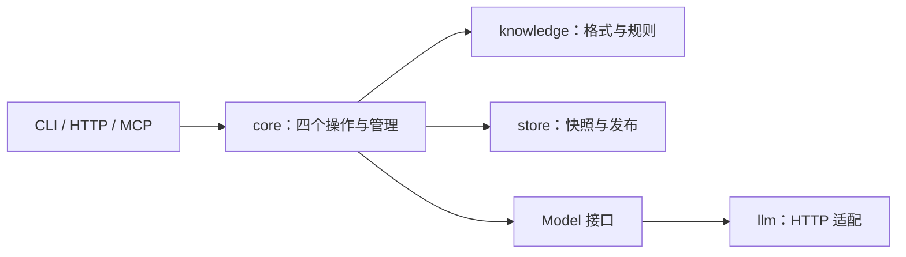

# Asteria 技术选型

本文件说明当前实现为何这样选，以及出现什么需求时再演进。系统自行开发，后端使用 Go，复用开源库。业务规则见[系统设计](Asteria-1.0-System-Design.md)，运行方式见 [README](README.md)。

## 当前选择

采用 **Go 单体 + 本地不可变 Markdown 快照 + 显式模型流程**。CLI、HTTP 和 MCP 共享同一核心；运行无需数据库、搜索服务或队列。

| 层次 | 当前组件 | 选择理由 |
| --- | --- | --- |
| 语言 | Go 1.25+ | 单一业务语言、标准并发与网络库、可编译为静态二进制；目前使用 Unix 文件锁 |
| HTTP | `net/http` | 现有路由、鉴权和取消需求可用标准库完成，无需额外 Web 框架 |
| CLI | [Cobra](https://github.com/spf13/cobra) | 命令、参数与帮助；四个操作和管理命令共用服务 |
| MCP | [官方 Go SDK](https://github.com/modelcontextprotocol/go-sdk) | stdio 与 Streamable HTTP 协议适配 |
| Markdown | [goldmark](https://github.com/yuin/goldmark) | 从 AST 识别真实链接和锚点，排除代码示例 |
| YAML | [go.yaml.in/yaml/v3](https://github.com/yaml/go-yaml) | 领域配置与 front matter，拒绝未知字段 |
| 模型 | `core.Model` + 标准库 HTTP 适配器 | 维护 OpenRouter、DeepSeek、Qwen、Kimi、GLM；复用兼容协议，集中处理服务差异 |
| 检索 | Go 中的词语与中文双字匹配、目录和显式引用 | 为原型提供可解释的入口；真实召回不足时再换检索实现 |
| 存储 | 普通文件、SHA-256、flock、原子 rename | 无外部服务即可验证版本、提案与发布规则 |
| 部署 | 静态二进制、Dockerfile、单实例 Compose | 非 root 容器、环境配置和持久卷；尚未验证 Docker 运行 |

实际依赖与精确版本以 [go.mod](go.mod) / [go.sum](go.sum) 为准。当前直接依赖只有 Cobra、MCP SDK、goldmark 和 YAML；不在本文重复维护一份版本清单。

## 代码边界



| 目录 | 维护职责 |
| --- | --- |
| `cmd/asteria`、`internal/cli` | 启动、参数与本地人类身份，不实现另一套知识规则 |
| `internal/transport` | HTTP / MCP 协议、鉴权和错误映射 |
| `internal/core` | 导航、四个操作、提案、审核、权限和依赖复核 |
| `internal/knowledge` | 领域类型、Markdown 编解码、稳定引用和位置检查 |
| `internal/store` | 不可变快照、HEAD 发布、来源、提案、轨迹和派生索引 |
| `internal/llm` | 提供商配置、协议差异和结构化结果校验；不具有直接提交知识或批准提案的权限 |

“模型工作流”指导航、读取、回答或提出修改的执行步骤。当前直接写成 Go 流程。**Eino 是可嵌入 Go 后端的模型与 Agent 编排库；Dify 是独立应用开发平台。** 需要复杂工具调用、流式输出或流程组合时，再通过模型接口评估 Eino；审核与提交始终属于 Asteria。

模型边界保留 `Complete(ctx, instruction, input, output)`。五家服务共用 HTTP 客户端、Bearer 鉴权和 JSON Object 解析，由提供商配置处理地址、OpenRouter 路由约束、Qwen 非思考模式和 Kimi 输出限制字段。模型 ID 不写死；部署通过环境变量或 Secret 注入配置，保留自定义端点。配置方法及官方文档见 [README](README.md#模型接入)。

只接收正常结束且符合业务结构的 JSON 对象，拒绝截断、拒答、供应商错误和额外字段。HTTP 错误保留提供商与状态码，响应正文不外传；超时与取消沿用 `context`，不自动重试或切换提供商。当前每个进程选择一个模型实例；流式、工具调用、嵌入与多模型路由按实际需求另行扩展。五家均有本地协议验证，真实凭据联调尚未完成。

## 存储与发布

```text
data/
  HEAD                              当前已发布提交
  versions/<commit>/manifest.json   提交、文件版本、已应用提案
  versions/<commit>/<library>/
    schema.json                     该版本的领域配置
    <domain-path>/<entry>.md         知识正文与元数据
  sources/<hash>                    原始来源快照
  proposals/<id>.json               确切提案与拒绝记录
  traces/<id>.json                  运行轨迹
  index.json                        可重建的目录与引用摘要
```

写锁覆盖基准检查、提案复查和发布。先准备并同步完整快照，再原子替换 HEAD；读者只沿 HEAD 读取已发布版本。索引在发布后生成，旧快照的重建任务不能覆盖新索引。

目录与查询直接从快照生成，目前不读取 `index.json`。这使索引故障不会隐藏已提交知识，也避免为小原型维护两套读取路径。索引重建只提取已保存内容。

这套实现的代价是完整快照复制、全量读取和单写锁，适用于单机原型。多个本地进程可以协调写入；多个机器共享目录或直接增加容器副本不属于支持范围。备份需保存整个数据目录，`export` 只是当前工作副本。

## 云原生演进条件

保留容器部署与模型可替换的方向，但按实际需要引入基础设施：

| 已确认的需求 | 候选组件 | 必须保持的边界 |
| --- | --- | --- |
| 多副本写入、共享发布记录 | PostgreSQL + [pgx](https://github.com/jackc/pgx) / [sqlc](https://github.com/sqlc-dev/sqlc) | 用事务检查基准和确切审批；本地文件锁不能承担分布式提交 |
| 知识与来源独立于应用实例 | S3 + [AWS SDK for Go v2](https://github.com/aws/aws-sdk-go-v2) | 内容不可变；对象存在不等于已发布；目录由清单表达 |
| 需要可恢复的后台内省或导入 | [River](https://github.com/riverqueue/river) 开源核心 | 任务随业务事务入队，按可能重试设计；等待审批不占住 Worker |
| 中文检索的规模或质量不足 | [gse](https://github.com/go-ego/gse) + PostgreSQL 全文索引 | 保留权限过滤与文件版本；先用真实问题验证收益 |
| 模型编排复杂度显著上升 | [Eino](https://github.com/cloudwego/eino) | 隔离框架类型，不用检查点代替审批记录 |
| 已有集群部署与运维要求 | Kubernetes / Helm、OpenTelemetry | 先外置状态，再扩容；备份恢复与观测需要实际验证 |

未来采用 PostgreSQL + S3 时，先写入并校验不可变对象，再在数据库事务中发布清单、head、历史和后续任务。这是原子发布，不是跨数据库与对象存储的分布式事务。跨库依赖变化也必须纳入同一发布边界；索引滞后不能导致遗漏复核。

独立搜索、向量库、图数据库和缓存服务均等待明确问题。后续评估高性能时，同时检查知识操作、模型轮次、权限、一致性和恢复成本。本轮只做功能验证与代码审查，不做压测，不保留未经证实的数字目标。
